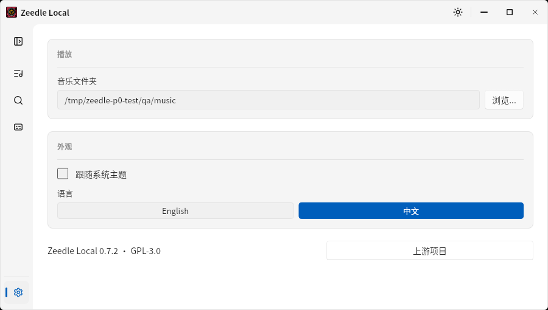

# SealMusic

基于 Rust、Rodio 和 Slint 的本地音乐播放器。在设置中选择音乐目录即可扫描其中的 MP3、FLAC、WAV 和 OGG 文件。双击收藏列表或搜索页中的歌曲开始播放。播放器只读歌曲标签和封面，歌词页优先显示内嵌的带时间戳歌词，也支持同名 UTF-8 `.lrc` 文件。

SealMusic 是 [Zeedle](https://github.com/Jordan-Haidee/zeedle) 的 fork，采用 GPL-3.0 许可证。

## 播放与桌面控制

- 在搜索页浏览本地曲库或查找歌曲。点击歌曲旁的心形按钮即可加入「我的喜欢」。在收藏页新建列表后，可使用歌曲旁的列表加号按钮添加歌曲。
- 点击列标题按歌名、歌手或时长排序。文本使用普通字符串顺序。排序后保留当前歌曲和播放历史。
- 循环按钮依次切换列表循环、单曲循环、关闭循环。随机播放可独立开关。
- 点击播放栏封面即可打开「歌词」和「待播清单」。点击清单中的歌曲即可播放。按 Esc 或点击顶部向下箭头返回。
- 空格播放或暂停，上下键切换歌曲，左右键快退或快进 15 秒。在「歌词」中，左右键跳到上一句或下一句。F1、F2、F4 打开收藏列表、搜索和设置，F3 展开或收起播放界面。
- 托盘或 Linux 桌面控制可用时，关闭窗口后仍可播放。托盘的“退出”和 Ctrl+Q 会结束进程。
- 设置页提供中英文切换、系统或手动主题、版本、许可证和上游项目入口。

在 Linux 上可以通过媒体键、Waybar 或 `playerctl` 控制播放。

```sh
playerctl -p sealmusic play-pause
playerctl -p sealmusic metadata
playerctl -p sealmusic position 10+
```

## 配置

配置保存在 `$XDG_CONFIG_HOME/sealmusic/config.toml`，默认位置是 `~/.config/sealmusic/config.toml`。如需导入上游设置，在播放器退出后将旧 TOML 复制到此位置。InOrder 映射为列表循环，Recursive 映射为单曲循环，Random 映射为列表循环并开启随机。旧“关于”页映射为设置页，已移除的语言回退到英语。



## 构建与打包

开发运行使用 `cargo run`。Linux 上使用 `cargo release --locked` 针对构建机器的 CPU 生成 `target/release/sealmusic`。需要把二进制分发到不同机器时，使用 `cargo build --locked --release` 采用默认的 CPU 目标。打包脚本使用 cargo-packager，产物位于 `target/release`。

| 平台 | 命令 |
| --- | --- |
| Linux | `./packager/pack-deb.sh`、`./packager/pack-appimage.sh` |
| Windows | `./packager/pack-nsis.ps1`、`./packager/pack-msi.ps1` |
| macOS | `./packager/pack-dmg.sh` |

Linux 包中的桌面入口和可执行文件使用 `sealmusic`。
