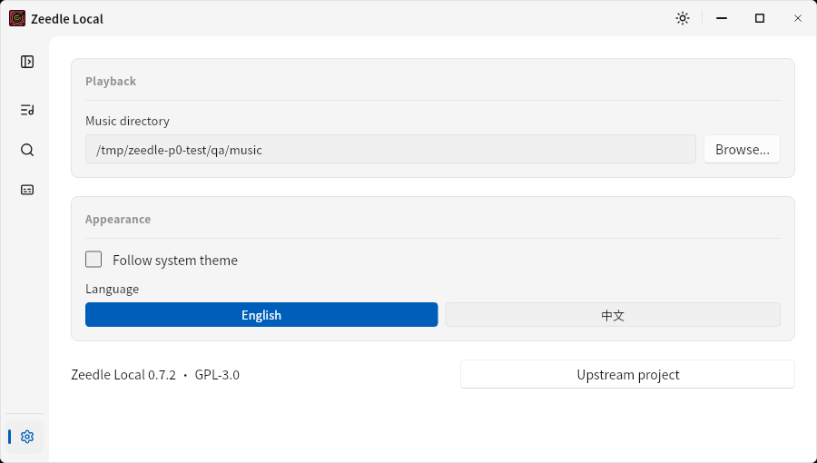

# SealMusic

A local music player built with Rust, Rodio and Slint. Choose a music directory in Settings to scan its MP3, FLAC, WAV, OGG and M4A files. M4A playback supports DRM-free AAC-LC and ALAC. Double-click a song in Collections or Search to play it. Metadata is read-only. The lyrics page supports embedded timed lyrics and UTF-8 sidecar files with the same basename and the extension `.lrc`.

SealMusic is a fork of [Zeedle](https://github.com/Jordan-Haidee/zeedle), licensed under GPL-3.0.

[中文介绍](README-zh.md)

## Playback

- Open Search to browse your local library or find songs. Click a song's heart to add it to My Likes. You can create named collections on the Collections page and add songs with the list-plus button.
- Click a column heading to sort by title, artist or duration. Text uses ordinary string order. Sorting preserves the current track and playback history.
- Repeat cycles through playlist, track and off. Shuffle can be enabled independently.
- Click the cover in the playback bar to open Lyrics and Playlist. The playlist shows all tracks in the active playback list and highlights the current track. Click any track to play it. Press Esc or click the down chevron to return.
- Space toggles playback. Up and Down select the previous and next track. Left and Right seek 15 seconds, or jump between timed lines in Lyrics. F1, F2 and F4 open Collections, Search and Settings. F3 toggles the expanded player.
- When the tray or Linux desktop media controls are available, closing the main window hides it and playback continues. Use the tray to reopen the window. Choose Exit from the tray or press Ctrl+Q to quit and save playback state.
- Settings includes English and Simplified Chinese, automatic or manual theme selection, the version, license and upstream project.

On Linux, MPRIS clients can control playback and query metadata. For example:

```sh
playerctl -p sealmusic play-pause
playerctl -p sealmusic metadata
playerctl -p sealmusic position 10+
```

## Configuration

The fork stores its configuration in `$XDG_CONFIG_HOME/sealmusic/config.toml`, defaulting to `~/.config/sealmusic/config.toml`. To import an upstream configuration, copy its TOML file there while the player is closed. InOrder becomes playlist repeat, Recursive becomes track repeat and Random enables shuffle with playlist repeat. The former About page opens Settings. Unsupported languages fall back to English.



## Linux rendering

SealMusic uses FemtoVG with OpenGL ES by default on Wayland. Set `SLINT_BACKEND=winit-femtovg` to select it explicitly. If OpenGL ES is unavailable, fully quit SealMusic and restart it with Slint's CPU renderer.

```sh
SLINT_BACKEND=winit-software ./target/release/sealmusic
```

## Build and package

Linux builds require the ALSA and PipeWire development libraries, `pkg-config`, and `libclang`. Audio follows the system's default output through PipeWire, PulseAudio, or ALSA, in that order. Build with `--no-default-features` to use PulseAudio and ALSA on systems without the PipeWire client library.

Run `cargo run` for development. On Linux, `cargo release --locked` builds `target/release/sealmusic` for the build machine's CPU. Use `cargo build --locked --release` for the default target CPU when distributing the binary across machines. The packaging scripts use cargo-packager and write their output to `target/release`.

| Platform | Commands |
| --- | --- |
| Linux | `./packager/pack-deb.sh`, `./packager/pack-appimage.sh` |
| Windows | `./packager/pack-nsis.ps1`, `./packager/pack-msi.ps1` |
| macOS | `./packager/pack-dmg.sh` |

The Linux packages install the desktop entry and executable as `sealmusic`.
